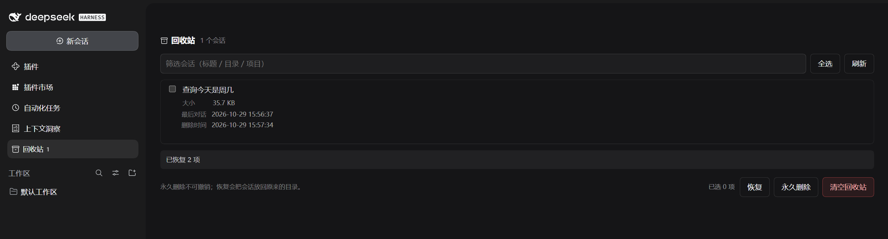
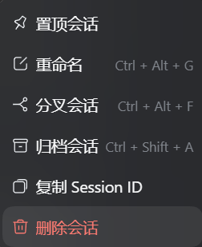
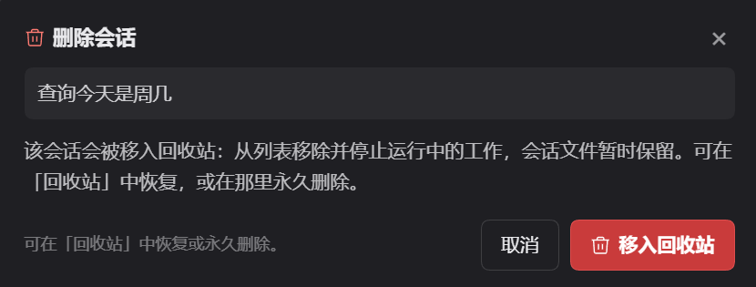

# dsh-delete-chat

[](https://github.com/abangbang/dsh-delete-chat/actions/workflows/ci.yml)
[](LICENSE)


**Delete a DSH conversation without losing it.**

DeepSeek Harness only archives: the row disappears from every list, the log stays on disk forever.
This plugin adds the real delete — with a safety net first. The directory is *moved* into
`~/.dsh/session-trash`, the sidebar gains a Trash page listing what is inside, and only an explicit
"delete permanently", behind a confirmation modal, ever unlinks a file.

English | [中文](README.zh-CN.md)

<p align="center">
  
</p>

## Why it exists

Two shipped DSH packages document the gap themselves:

> "**Does not delete session files** — logs accumulate under `root` until removed externally.
> The seam has **no delete interface**."
> — `@deepseek-ai/dsh-session-persistence-jsonl`

> "Removing a project keeps its folder, files and session history … while **session deletion and
> folder removal are independent features that are not yet provided**."
> — `@deepseek-ai/dsh-workspace`

"Delete workspace" only touches the list, "archive" only hides, so `~/.dsh/sessions` only grows.
This plugin is the scissors.

## What you get

| | |
|---|---|
| **Soft delete** | Session row "⋯" → Delete chat `rename`s the directory into `~/.dsh/session-trash`. Same volume, so it is instant, atomic, and copies nothing |
| **A trash page** | The sidebar's panel list gains "🗄 Trash · 3"; selecting it replaces the centre column with a page (the same kind the Plugins manager uses): filter, multi-select, restore, permanent delete, empty |
| **A modal for every verb** | Restore, delete and empty each open a confirmation naming the count, the bytes it frees and whether it is reversible. Only the confirm button touches the disk |
| **Full row details** | Size, absolute path inside the trash, last activity and deletion time (`YYYY-MM-DD HH:mm:ss`) |
| **Hard to lose by accident** | The permanent verbs exist only inside the trash; every other entry point is reversible |
| **Localized** | Wording follows the host language (zh / en) live — row, modal and page all re-render on a switch |
| **Both layouts** | Per-project `<root>/<project>/session-<uuid>/` and flat `<root>/session-<uuid>/` |
| **CLI** | `--trash` / `--trash-list` / `--restore` / `--purge --yes` / `--empty --yes`, usable without the GUI |
| **Self-hosted index** | Ships a format-1 market index — add it as an index source for a private market |

## Screenshots

<p align="center">
  
</p>

<p align="center">
  
  &nbsp;&nbsp;
  
</p>

<p align="center">
  
</p>

## Install
In DSH, just ask:

> Install https://github.com/abangbang/dsh-delete-chat

Chinese works too: 帮我安装 https://github.com/abangbang/dsh-delete-chat

Restart DSH afterwards. The plugin tree — and the client bundle, which is served with `immutable`
cache headers — are both composed at boot, so a page refresh is not enough.

## Usage

### Delete

Session row → **"⋯" → Delete chat** → confirm. The row leaves the list, running work stops, and the
directory moves into the trash:

```
Status   moved to trash
Size     274.4 KB
```

Nothing is lost: this is a rename, and it stays reversible until you say otherwise.

### The trash

The sidebar's panel list (the nav above the workspaces, `aria-label="全局面板"`) gains a
**🗄 Trash · 3** row:

- the count follows the row's own text colour, is **hidden at zero**, shows `99+` above that, and
  moves the moment a delete lands;
- collapsed to the 56px rail it drops the name, keeping icon and count;
- selecting it opens a **page** listing every trashed conversation:

```
alpha conversation
  Size           2.0 KB
  Location       ~/.dsh/session-trash/--proj--/session-…
  Last activity  2026-10-27 17:08:07   ← the log's mtime; rename keeps it
  Deleted        2026-10-29 09:02:03
```

On that page:

- **filter** by title, path or project;
- **select** one row or all of them — the footer counts the selection;
- **Restore** moves the directories back, re-accounts them and unarchives them;
- **Delete permanently** and **Empty trash** live only here, and each asks first: a modal naming the
  count, the bytes it frees and that it cannot be undone.

The restore confirmation is amber; only the deleting ones are red. Colour is meaning here, not
decoration.

## How it works

### Moving a conversation to the trash

| Step | Action | Why this order |
|---|---|---|
| 1 | `archiveSession(id, { stopActivity: true })` | Hides the row everywhere immediately, stops a running turn, and `ArchivedSessionGate` refuses later wakes |
| 2 | `rename` `<sessions-root>/…/session-<uuid>/` → `<home>/session-trash/<project>/session-<uuid>/` | Same volume, so the move is instant and atomic; a root on another volume falls back to copy + remove (`EXDEV`) |
| 3 | Rewrite `storages/workspace.json` | Drops the id from `sessionIds` so the sidebar row cannot come back; `.bak-<stamp>` kept |
| 4 | Update `<home>/session-trash/index.json` | Keeps title, cwd, size, last activity and deletion time without decoding a single zstd frame |

### The trash layout

```
~/.dsh/
├── sessions/                      # live sessions
│   └── <project>/session-<uuid>/
└── session-trash/                 # everything you deleted
    ├── index.json                 # titles, cwd, sizes, timestamps
    └── <project>/session-<uuid>/  # the directory, byte for byte
```

**The directory tree is the truth**: a directory the manifest does not know is listed with its id as
the title, and a manifest row whose directory vanished is reported as `missing` instead of being
shown.

Restore reverses steps 2–3 and asks the live registry to re-project the row (`insertSessionBefore`)
when it can. Permanent deletion — only ever reachable from the trash — unlinks the directory,
forgets the manifest row and clears the projection cache.

## When it fails

| What failed | What you see | What is actually true |
|---|---|---|
| The host call itself | dialog phase `error`, red box | Nothing was written |
| The move refused (on Windows: a directory another process holds) | dialog error carrying `EBUSY`/`EPERM` | The archive already ran; the directory is still in the sessions root, so unarchive it and it is back |
| `workspace.json` rewrite refused after a good move | the trash row exists, the sidebar row may linger | Files are safe in the trash; restore them, or clear the stale reference by hand |
| A purge cannot unlink | the page lists path + reason, and `N failed` | The other selections were deleted; the failing one is still listed |
| Restore cannot move back | `N failed` with the path | The directory is still in the trash; nothing was half-moved |

Recovery, in the order to try it:

1. **Restore** — anything in the trash comes back with one click; that is the whole point.
2. **Retry** — the dialog and the page are idempotent: run them again after fixing the cause (close
   the handle, quit the sync client).
3. **CLI fallback** — quit DSH first; the lock that blocks a directory is usually the host's own
   handle. `dsh-delete-chat --trash | --restore | --purge --yes`.
4. **Roll back the store** — every rewrite leaves `workspace.json.bak-<stamp>` next to it.

## Known limitations

- **The trash is not the OS recycle bin.** It lives at `<DSH home>/session-trash`; deleting that
  directory by hand is a permanent delete that bypasses every confirmation.
- **Restore may need a restart.** The live row comes back immediately when the workspace registry
  exposes `insertSessionBefore`; without it the directory is restored and the row reappears on the
  next boot.
- **No cascade**: subagent and forked child sessions survive on their own, and their
  `parent_session` dangles.
- **Attachments untouched**: `~/.dsh/attachments/v1/objects` is content-addressed and shared, so
  neither trashing nor purging one session deletes objects other sessions still reference.
- **In-memory object lingers**: the `sessions` service exposes only `create`/`get`/`list`, so a
  trashed session's object stays until restart. It runs no model step while archived.

## License

[MIT](LICENSE). Listing ≠ endorsement: this is third-party code; install only from sources you
trust.
