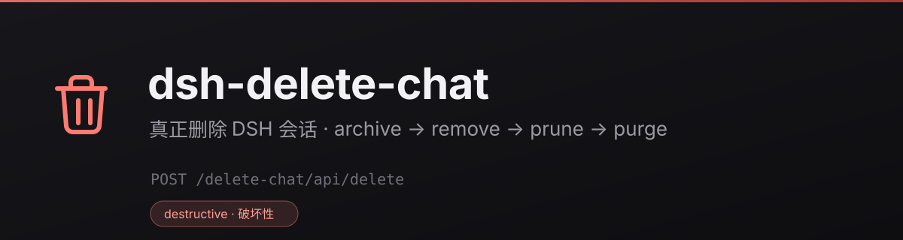

# dsh-delete-chat

**Real session deletion for DeepSeek Harness.** DSH ships archive-only session management:
archiving hides a conversation from every list, but the log stays on disk forever. This plugin
adds the missing verb — archive, remove the directory, prune workspace accounting, clear the
projection cache — behind a confirmation dialog that reports what it actually did.

English | [中文](README.zh-CN.md)

<p align="center">
  
</p>

---

## Why it exists

Two shipped packages document the gap themselves:

> "**Does not delete session files** — logs accumulate under `root` until removed externally.
> The seam has **no delete interface**."
> — `@deepseek-ai/dsh-session-persistence-jsonl`

> "Removing a project keeps its folder, files and session history … while **session deletion and
> folder removal are independent features that are not yet provided**."
> — `@deepseek-ai/dsh-workspace`

"Delete workspace" only touches the list. "Archive" only hides. `~/.dsh/sessions` therefore only
grows — this plugin is the scissors.

## Features

| | |
|---|---|
| **Row menu** | Session row "⋯" → Delete session, trash glyph, danger red, red-tinted hover |
| **Localized** | Wording follows the host language (zh / en) live — the row and an already-open dialog both re-render on a switch |
| **Confirmation** | Title, disk usage, directory count; then a field-by-field report |
| **Actually deletes** | Archive (stops running work) → recursive directory removal → atomic `workspace.json` rewrite (with backup) → projection-cache purge |
| **Both layouts** | Per-project `<root>/<project>/session-<uuid>/` and flat `<root>/session-<uuid>/` |
| **CLI fallback** | `dsh-delete-chat --list / --preview / --yes`, usable without the GUI |
| **Self-hosted index** | Ships a format-1 market index — add it as an index source for a private market |

## Install

### Plugin market

Host → **Settings → Plugins → Discover → Index sources**, add:

```
https://cdn.jsdelivr.net/gh/YOUR_GITHUB_USER/dsh-delete-chat@main/market/index.json
```

(Icon paths in the index are relative; jsDelivr serves the whole repo as a static site, so they
resolve.)

### Command line

```bash
dsh plugin --profile <your-profile> add https://github.com/YOUR_GITHUB_USER/dsh-delete-chat/archive/refs/heads/main.tar.gz
```

On the official desktop app the profile belongs to the app's own plugin manager — install through
**Settings → Plugins** instead.

### Script (any OS)

```bash
node scripts/install.mjs                  # install into ~/.dsh/profiles/desktop
node scripts/install.mjs --profile <dir>  # any profile
node scripts/install.mjs --dry-run        # print the patch diff, write nothing
node scripts/install.mjs --uninstall      # unmount + delete the package copy

./install.sh                              # macOS / Linux wrapper
.\install.ps1                             # Windows wrapper (also -Uninstall / -DryRun)
```

The wrappers only translate switches — the installer is one Node script, so all three OSes run the
same code, and it strips the pre-rename mount (`dsh-session-delete`) so an upgraded profile never
ends up with two.

### Manual mount

```bash
git clone https://github.com/YOUR_GITHUB_USER/dsh-delete-chat.git \
  ~/.dsh/profiles/desktop/node_modules/dsh-delete-chat
```

Then append to the profile's `cordis.patch.yml`:

```yaml
- insert:
    - id: delete-chat
      name: 'dsh-delete-chat'
```

**Restart DSH afterwards.** The plugin tree is composed at boot, and the client bundle is composed
at boot too and served with `immutable` cache headers — a page refresh returns the old bundle.

> ⚠️ Do not mount twice: after installing through `dsh plugin add` (which reads this package's
> `dsh.bundle.patch` and inserts the row itself), delete the hand-written `- insert:` block.

## Usage

Sidebar → session row → **"⋯" → Delete session** → confirm.

The dialog shows disk usage first, then the outcome:

```
Status        deleted
Archive       archived, running work stopped
Directories   1 removed
Freed         274.4 KB
Accounting    3 references removed
Proj. cache   1 entry cleared
```

### CLI

```bash
dsh-delete-chat --list                    # every session: size, archived, pinned, live
dsh-delete-chat --preview session-<uuid>  # read-only
dsh-delete-chat --yes session-<uuid>      # delete
dsh-delete-chat --home D:\other\.dsh --list
```

Without `--yes` it prints the preview and exits `1`.

## How it works

One deletion, four actions, fixed order:

| Step | Action | Why this order |
|---|---|---|
| 1 | `archiveSession(id, { stopActivity: true })` | Hides the row everywhere immediately, stops a running turn, and `ArchivedSessionGate` refuses later wakes — nothing re-surfaces while files disappear |
| 2 | Recursively remove `<sessions-root>/…/session-<uuid>/` | Takes `session.v4.jsonl.zstd` with it |
| 3 | Rewrite `storages/workspace.json` | Drops `sessionIds` / `archivedSessionIds` / `pinnedSessionIds`; temp file + atomic rename, original kept as `.bak-<stamp>` |
| 4 | Purge `storages/session_projcache/<id>.*` | Otherwise search keeps entries that cannot be opened |

A step-1 failure is not fatal — a session unknown to the workspace registry still gets its files
removed, and the report says so.

### API

`POST /delete-chat/api/{list,preview,delete}`, fenced by the host's own
`connection.requestRejection`. `sessionId` must start with `session-` and contain only
`[0-9A-Za-z._-]`: it is validated before it ever reaches `join()`/`rm()`, so `../`, drive letters
and separators cannot become path segments.

## When it fails

Nothing is atomic here — a delete touches a live host, a directory tree and a JSON store. The
report says which part refused, and every failure has a way forward.

| What failed | What the dialog shows | What is actually true |
|---|---|---|
| `POST /delete-chat/api/delete` itself | phase `error`, red box, session untouched | Nothing was written |
| One directory would not go (file lock, permissions, OneDrive sync) | status **partially deleted**, path + reason listed | The other paths are gone; the row is already archived |
| `workspace.json` rewrite refused | status **partially deleted**, store path listed, `.bak-<stamp>` kept | Files are gone, the stale reference is pruned on the next boot |
| A projection-cache entry refuses | status **partially deleted**, that one cache path listed | The session log is gone — only a disposable cache file remains |

Recovery, in the order to try it:

1. **Retry** — the dialog keeps a retry button whenever the report lists failures. The operation is
   idempotent: a second call re-archives (no-op), re-removes what is left, and re-prunes.
2. **Copy failure details** — the machine-readable report, ready for a bug report.
3. **CLI fallback** — the same footer shows the exact command. Quit DSH first: the lock that
   usually blocks a directory is the live host's own write handle.
   ```bash
   dsh-delete-chat --yes session-<uuid>
   ```
4. **Roll back the store** — every rewrite leaves `workspace.json.bak-<stamp>` next to it.
5. **Bring the conversation back** — if the files survived (a directory-failure-only run), the
   archive is reversible: unarchive the session and it returns to its list.

## Platform support

| | Windows | macOS | Linux |
|---|---|---|---|
| Plugin runtime (host + client half) | ✅ verified locally | ✅ CI, `macos-latest` | ✅ CI, `ubuntu-latest` |
| Installer (`scripts/install.mjs` + wrappers) | ✅ verified locally | ✅ same suite | ✅ same suite |
| A directory another process holds | refused (`EBUSY`) → reported, retry offered | removed (POSIX `unlink`) | removed (POSIX `unlink`) |
| Sessions root behind a symlink (macOS `tmpdir` shape) | n/a | ✅ covered | ✅ covered |
| Path derivation | drive-letter roots | POSIX roots | POSIX roots |

Windows and POSIX assertions live in one file (`test/platform.test.mjs`) and are mutually exclusive:
the branch that does not belong to the running OS is skipped **with a reason**, so a green run on one
platform never stands in for another. `npm test` is 71 tests.

The only platform difference users actually hit is the middle row: on Windows a directory held open
by another process cannot be removed, so the plugin reports `EBUSY`, offers *Retry*, and prints the
CLI fallback — quit DSH, then `dsh-delete-chat --yes <id>`. On macOS and Linux that same deletion
simply succeeds.

## Known limitations

- **No cascade**: subagent and forked child sessions survive, and their `parent_session` dangles.
- **Attachments untouched**: `~/.dsh/attachments/v1/objects` is content-addressed and shared, so
  deleting one session must not delete objects other sessions still reference.
- **In-memory object lingers**: the `sessions` service exposes only `create`/`get`/`list`, no
  dispose. An archived session runs no model step, and the object disappears on restart.
- **`workspace.json` may be rewritten once** by the host from its in-memory projection. The
  archive set still hides the row; a restart leaves it fully clean.

## Development

```bash
npm test                 # 30 tests: host logic / HTTP envelope / client bundle contract
npm run pack             # release/dsh-delete-chat-<version>.tgz
npm run market-index     # regenerate market/index.json from HEAD
npm run rename-owner --  <github-user> [display-name]
```

All three suites run against `mkdtemp` fixtures and a fake context — no running DSH, no real data.

## License

[MIT](LICENSE). Listing ≠ endorsement: this is third-party code; install only from sources you
trust.
